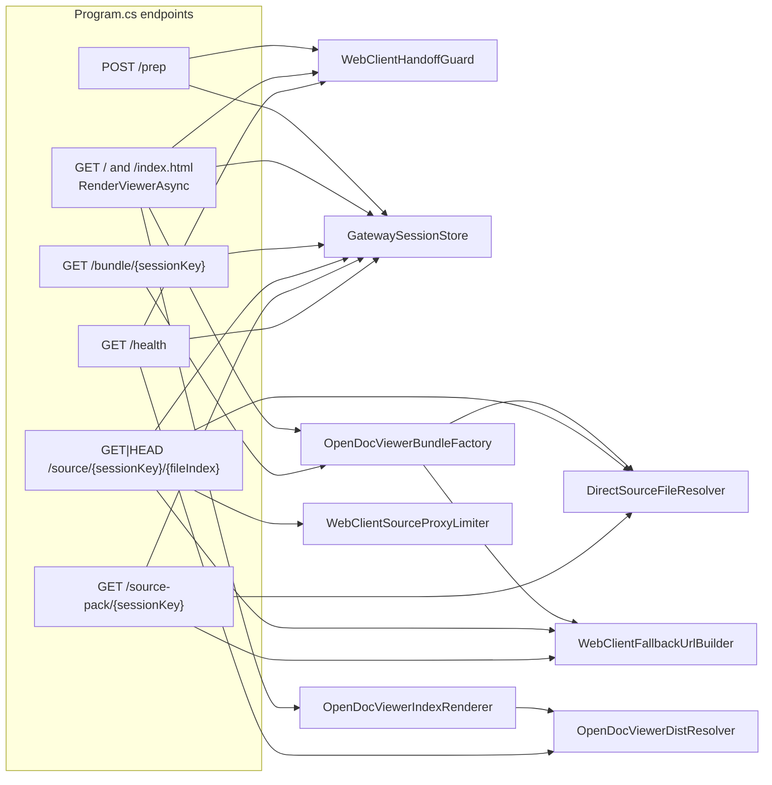
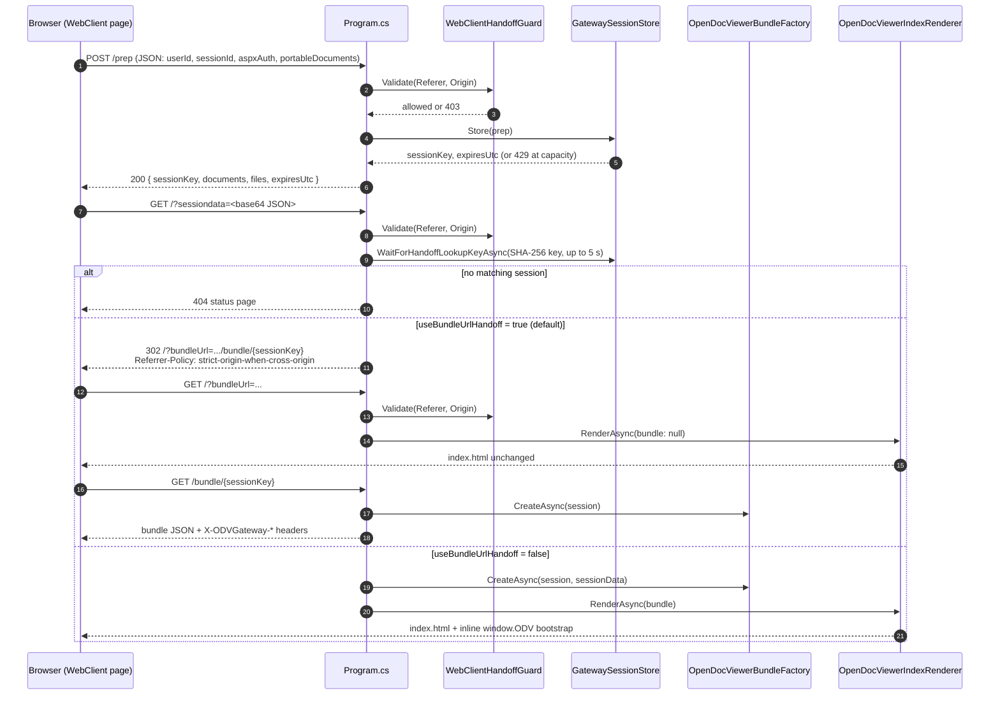
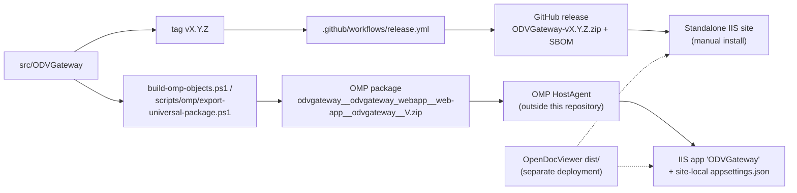

# ODVGateway architecture

This document describes ODVGateway as the code builds it today. Every statement
names the file or folder that backs it. Statements that could not be checked in
this repository are marked **unverified**. Re-checked against the source on
2026-11-21 (application version `0.1.45` in `Directory.Build.props`, OMP
artifact version `0.1.87` in `omp-components.json`).

Read this document for the structure. Read [README.md](../README.md) for the
quickstart and the full settings tables, [SECURITY.md](../SECURITY.md) for the
hardening checklist, and [AGENTS.md](../AGENTS.md) for the repository workflow.

## 1. Purpose and scope

ODVGateway is one ASP.NET Core minimal-API web application. It turns a host
WebClient document selection into an OpenDocViewer session and streams the
document bytes to that viewer.

It does three things:

- It accepts a WebClient `/prep` payload and keeps it as an in-memory session
  (`src/ODVGateway/Program.cs`, `Services/GatewaySessionStore.cs`).
- It serves the OpenDocViewer single-page app from a configured `dist/` folder
  and injects or links a session bundle (`Services/OpenDocViewerIndexRenderer.cs`,
  `Services/OpenDocViewerBundleFactory.cs`).
- It delivers source files, either read from trusted server-side roots or
  fetched from the WebClient ticket stream (`Services/DirectSourceFileResolver.cs`,
  `Services/WebClientFallbackUrlBuilder.cs`, `Program.cs`).

ODVGateway deliberately does **not**:

- contain viewer code. The viewer is the separate OpenDocViewer project, served
  as static files from its built `dist/` folder (`Program.cs` `UseStaticFiles`).
- authenticate users. There is no authentication middleware in `Program.cs`.
  The trust boundary is the WebClient handoff (see [Security model](#7-security-model)).
- own a database. `odvgateway.module-definition.json` declares
  `"sqlScripts": []` and no required tables.
- persist sessions. Sessions live in process memory only
  (`GatewaySessionStore`).
- serve arbitrary files. Direct reads require `trustClientFilePath=true` and a
  path below a `trustedSourceRoots` entry (`DirectSourceFileResolver.TryResolve`).
- convert or decode documents. Source bytes are streamed unchanged; decoding
  happens in OpenDocViewer (`Services/ContentTypeMapper.cs` only maps an
  extension to a MIME type).

## 2. Components

The repository holds one deployable project, one test project and tooling.

| Path | Responsibility | Depends on |
| --- | --- | --- |
| `src/ODVGateway/` | The web application (`ODVGateway.csproj`, `net10.0`, `Microsoft.NET.Sdk.Web`). | ASP.NET Core 10, `NLog.Web.AspNetCore` 6.2.2 |
| `tests/ODVGateway.Tests/` | xUnit v3 unit tests and `WebApplicationFactory` HTTP tests. Never packaged. | `src/ODVGateway` |
| `tests/scripts/` | Pester suites for the PowerShell tooling. | `scripts/omp/run-script-tests.ps1` |
| `scripts/` | Local CI gate, smoke test, release helper, hook setup. | .NET SDK, PowerShell 7 |
| `scripts/omp/` | OMP packaging and version-lockstep tooling, kept identical to OpenModulePlatform copies (Check 15). | An OpenModulePlatform checkout for drift checks |
| `tools/appsettings-generator/` | Builds and drift-checks a site `appsettings.json`. Not packaged. | PowerShell |
| `build/` | Deterministic-build MSBuild imports (`Directory.Build.targets`). | MSBuild |
| `demo/` | Sample source files used by the development configuration. | — |

Inside `src/ODVGateway/` the code splits into these units. All services are
registered as singletons in `Program.cs`.

| Unit | File | Responsibility |
| --- | --- | --- |
| Host and endpoints | `Program.cs` | Middleware pipeline, endpoint mapping, `/source` proxy, `/source-pack` writer, startup validation. |
| Options | `Options/ODVGatewayOptions.cs` | The `ODVGateway` configuration section and its defaults. |
| Models | `Models/WebClientModels.cs`, `Models/GatewaySession.cs`, `Models/OpenDocViewerBundleModels.cs` | WebClient input shapes, the stored session, the viewer bundle shape. |
| `WebClientHandoffGuard` | `Services/WebClientHandoffGuard.cs` | Checks `Referer`/`Origin` against `webClientHandoff.allowedInitiatorUrls`. |
| `WebClientPrepReader` | `Services/WebClientPrepReader.cs` | Reads the `/prep` JSON body with a byte cap. |
| `WebClientSessionDataDecoder` | `Services/WebClientSessionDataDecoder.cs` | Decodes the base64 JSON `?sessiondata=` token. |
| `SessionKeyFactory` | `Services/SessionKeyFactory.cs` | Random public session key; SHA-256 handoff lookup key. |
| `GatewaySessionStore` | `Services/GatewaySessionStore.cs` | In-memory session table with TTL, capacity cap and handoff lookup. Also parses file tickets (`FileTicket.Parse`). |
| `OpenDocViewerDistResolver` | `Services/OpenDocViewerDistResolver.cs` | Finds the OpenDocViewer `dist/` folder. |
| `OpenDocViewerBundleFactory` | `Services/OpenDocViewerBundleFactory.cs` | Builds the viewer bundle: documents, file URLs, metadata, aliases, diagnostics. |
| `OpenDocViewerIndexRenderer` | `Services/OpenDocViewerIndexRenderer.cs` | Serves `index.html`, optionally with an inline `window.ODV` bootstrap script. |
| `DirectSourceFileResolver` | `Services/DirectSourceFileResolver.cs` | Enforces `trustClientFilePath` and `trustedSourceRoots`; opens files. |
| `WebClientFallbackUrlBuilder` | `Services/WebClientFallbackUrlBuilder.cs` | Builds a WebClient URL for a file the gateway cannot read directly. |
| `WebClientSourceProxyLimiter` | `Services/WebClientSourceProxyLimiter.cs` | Semaphore that caps concurrent `/source` proxy requests (`proxyMaxConcurrency`). |
| `ContentTypeMapper` | `Services/ContentTypeMapper.cs` | Extension to MIME type, built-in map plus `contentTypes` overrides. |
| `GatewayHtml`, `OmpThemePreference` | `Services/GatewayHtml.cs`, `Services/OmpThemePreference.cs` | HTML-encoded status pages themed from the `OMP_THEME_PREFERENCE` cookie. |
| `FlexibleStringJsonConverter` | `Services/FlexibleStringJsonConverter.cs` | Accepts numbers or strings where WebClient JSON is loose. |



## 3. Runtime view

### Process and middleware

ODVGateway is a single process. It runs in-process under IIS through the
ASP.NET Core Module (`src/ODVGateway/web.config`, `hostingModel="inprocess"`)
or as a plain Kestrel process. The development profile listens on
`http://localhost:8095` (`Properties/launchSettings.json`). No port is fixed
for production; IIS or the host decides it.

`Program.cs` builds this pipeline, in order:

1. NLog replaces the default logging providers (`builder.Host.UseNLog()`).
2. Kestrel drops the `Server` header (`AddServerHeader = false`).
3. Startup validation: when `trustClientFilePath` is true, an empty or relative
   `trustedSourceRoots` list throws and the process does not start
   (`ValidateTrustedSourceRootConfiguration`).
4. Startup warnings for `useBundleUrlHandoff=false`, an empty
   `allowedInitiatorUrls` list and `allowMissingInitiatorHeaders=true`
   (`LogProductionCompatibilityWarnings`).
5. Correlation middleware: reuses a valid `X-Correlation-ID` (at most 128 HTTP
   token characters) or creates one, echoes it, and opens a logging scope.
6. Exception handler returning a fixed `500` text, then status-code pages.
7. Response compression (including `application/json`, also over HTTPS).
8. Security headers on every response: `X-Frame-Options: SAMEORIGIN`,
   `X-Content-Type-Options: nosniff`, `Referrer-Policy: no-referrer`,
   `X-Robots-Tag: noindex`, `Content-Security-Policy`
   (`DefaultContentSecurityPolicy` unless `contentSecurityPolicy` is set).
9. Static files from the dist folder resolved **at startup**. `index.html` gets
   `no-store`; every other dist file gets `public, max-age=31536000, immutable`.
10. Mapped endpoints.

### Endpoints

| Endpoint | Handler in `Program.cs` | Result |
| --- | --- | --- |
| `GET /health` | `MapGet("/health")` | JSON snapshot; `200` with `status: "ok"`, `503` with `status: "degraded"` when no dist folder resolves. |
| `POST /prep` | `MapPost("/prep")` | `200` with `sessionKey`, counts and `expiresUtc`; `400` bad payload; `403` guard rejection; `429` store full. |
| `GET /`, `GET /index.html` | `RenderViewerAsync` | Viewer HTML, a `302` to `?bundleUrl=`, or a status page (`400`, `404`, `503`). |
| `GET /bundle/{sessionKey}` | `MapGet("/bundle/{sessionKey}")` | Bundle JSON with `X-ODVGateway-*` diagnostics headers; `404` when unknown or expired. |
| `GET`/`HEAD /source/{sessionKey}/{fileIndex:int}` | `MapMethods("/source/...")` | One file: direct with range support, or an upstream proxy; `403`, `404`, `502`, or a forwarded upstream failure status. |
| `GET /source-pack/{sessionKey}` | `MapGet("/source-pack/{sessionKey}")` | All files of the session in one `odvsp1` stream. |

### Flow 1: handoff and viewer start

WebClient posts `/prep` and points the iframe at `?sessiondata=` at the same
time, so the two requests can race (comment on `PrepHandoffWaitMilliseconds` in
`Options/ODVGatewayOptions.cs`).



Step by step, from the code:

1. `/prep` runs `WebClientHandoffGuard.Validate`, then
   `WebClientPrepReader.ReadAsync` (cap `maxPrepBodyBytes`, default 50 MiB).
2. `GatewaySessionStore.Store` prunes expired sessions, checks
   `maxConcurrentSessions`, and creates the session. The public `sessionKey` is
   32 random bytes as hex. The internal handoff lookup key is a SHA-256 hash of
   `userId`, `sessionId`, `aspxAuth` and the document IDs
   (`SessionKeyFactory.CreateHandoffLookupKey`).
3. `Store` flattens every `portableDocuments[].fileData[]` entry into a
   `GatewaySourceFile` with a global index. `FileTicket.Parse` reads
   `fileId|extension|filePath`, or treats the whole value as a path. It never
   rejects a malformed ticket.
4. The viewer request decodes `?sessiondata=` into `userId`, `sessionId`,
   `aspxAuth` and `caseIds`, computes the same lookup key, and polls the store
   every 50 ms for up to `prepHandoffWaitMilliseconds` (clamped to 0–30000).
5. With `useBundleUrlHandoff=true` the gateway answers with a redirect to
   `{PathBase}/?bundleUrl=<absolute bundle URL>&odvDocs=<n>&odvFiles=<n>`
   (`BuildViewerBundleUrl`). The redirect overrides `Referrer-Policy` so the
   follow-up request still carries the WebClient `Referer`.
6. A request with `bundleUrl` (or `sessionUrl`) in the query is validated again
   and served `index.html` as is. OpenDocViewer then fetches the bundle itself.
7. Without `?sessiondata=` the gateway shows a `400` page, unless
   `allowOpenDocViewerFallbackWithoutSession` is true. Then it serves the bare
   viewer.

### Flow 2: source delivery

The bundle tells the viewer two things: one URL per file
(`OpenDocViewerFile.Url`) and a `sourcePackUrl` with
`sourceTransport: "source-pack-stream"` (`OpenDocViewerBundleFactory.CreateAsync`).
Which of the two the viewer uses is decided in OpenDocViewer (**unverified**
here).

Per file, the bundle factory chooses the URL like this:

1. If `DirectSourceFileResolver.TryResolve` succeeds, the URL is
   `/source/{sessionKey}/{index}` and the size is known.
2. Otherwise `WebClientFallbackUrlBuilder.BuildFallbackUrl` tries the
   `filePath` as a browser URL, then `webClientSourceFallback.urlTemplate`
   (default `/WebClientODV/DocumentView/GetStream/?ticket={fileId}`).
3. If a fallback URL exists and the session has at least
   `proxyThroughGatewayAboveSourceCount` files (default 1000; `0` means always),
   the URL is the gateway's `/source/...`, which proxies. Below the threshold
   the viewer gets the WebClient URL and the browser fetches it directly.
4. If nothing applies, the URL is `/source/...`, which answers `403` or `404`.

`/source/{sessionKey}/{fileIndex}`:

- Direct file: `Results.File` with `enableRangeProcessing: true` and
  `Cache-Control` from `sourceCacheControl`.
- Proxied file: waits for a `WebClientSourceProxyLimiter` slot, then
  `ProxyWebClientSourceAsync` fetches the URL with `HttpClient`
  (`"ODVGateway.RemoteInline"`). It forwards the session's `aspxAuth` and
  `sessionId` values as cookies named in `remoteInlineSources.aspxAuthCookieNames`
  and `sessionCookieNames`. It retries on 408, 429 and 5xx up to
  `remoteInlineSources.retryCount` times with a linear back-off, and times out
  each attempt after `remoteInlineSources.requestTimeoutMs`. Responses larger
  than `maxSourceProxyBytes` return `502`. A response without
  `Content-Length` is buffered fully (spilling to disk above 64 KiB) before the
  first byte is sent.

`/source-pack/{sessionKey}` always reads every file through the gateway: direct
when possible, otherwise from the fallback URL with the same cookies and
retries. It ignores the proxy threshold and the proxy limiter. A failed file
becomes a frame with `ok: false` and an error text; the stream continues.

### Flow 3: health probe

`GET /health` resolves the dist folder again, counts active sessions (pruning
expired ones), and returns configuration values: limits, whether direct files
are enabled, the number of trusted roots and allowed initiators, and the guard
rejection count. It returns the literal dist path only when
`exposeOpenDocViewerDistPathInHealth` is true.

## 4. Data

ODVGateway has no database and writes no business data to disk.

| Data | Where | Owner | Lifetime |
| --- | --- | --- | --- |
| Prepared sessions (`GatewaySession`: prep payload incl. `aspxAuth`, file list, timestamps) | Two `ConcurrentDictionary` instances in `GatewaySessionStore` | This process | `sessionTtlMinutes` (minimum 5), pruned on every store access; lost on restart |
| Source documents | Trusted local or UNC roots, or the WebClient ticket stream | Host system | Not copied by the gateway |
| Proxy buffers | `FileBufferingWriteStream` in the ASP.NET Core temp directory | This process | Deleted when the request ends |
| Logs | `${basedir}/logs/ODVGateway-${shortdate}.log` and console (`NLog` section of `appsettings.json`) | Operator | No rotation limit configured in the shipped file |
| OpenDocViewer app | The `dist/` folder | OpenDocViewer deployment | Read-only to the gateway |

### Wire formats

**`/prep` body** (`Models/WebClientModels.cs`, case-insensitive JSON):
`userId`, `sessionId`, `aspxAuth`, and `portableDocuments[]` with `documentId`,
`created`, `modified`, `sourceid`, `metaData[]` (`id`, `value`, `lookupValue`)
and `fileData[]` (strings, `fileId|extension|filePath`).

**`?sessiondata=` token** (`WebClientSessionDataDecoder`): base64 or base64url
JSON with `userId`, `sessionId`, `aspxAuth`, `caseIds[]`.

**Bundle** (`Models/OpenDocViewerBundleModels.cs`, built by
`OpenDocViewerBundleFactory`): `session` (`id`, `userId`, `issuedAt`),
`documents[]` (`documentId`, `documentVersion`, `files[]`, `meta`, `metaById`,
`metadata`, `metadataDetails`), and an `integration` dictionary with transport
facts and counters. Metadata field `504` is read as a page-count hint
(`ResolveDocumentPageCountHint`).

**`odvsp1` source pack** (`WriteSourcePackAsync`, `WriteSourcePackFrameAsync`),
served as `application/vnd.opendocviewer.source-pack` with
`X-ODVGateway-Source-Pack: odvsp1` and `X-ODVGateway-Source-Count`:

```text
"ODVSP1\n"                                   7 ASCII bytes
repeat per file, ordered by index:
  uint32 little-endian   length of the JSON header
  JSON header            { ok, fileIndex, fileId, ext, displayName,
                           contentType, payloadBytes, error }
  payloadBytes bytes     the file content (0 bytes when ok = false)
uint32 0                 end marker (4 zero bytes)
```

Each frame is capped by `maxSourcePackFrameBytes` (default 64 MiB).

## 5. Integration points

| Party | Direction | Contract | Where |
| --- | --- | --- | --- |
| Host WebClient | WebClient calls the gateway | `POST /prep` JSON, then `GET /?sessiondata=`; WebClient's `PathToVideoEditUtility` points at the gateway URL (README, Standalone IIS Deployment) | `Program.cs`, `Models/WebClientModels.cs` |
| Host WebClient ticket stream | Gateway calls WebClient (HTTP GET with forwarded cookies) or hands the URL to the browser | `webClientSourceFallback.urlTemplate`, default `/WebClientODV/DocumentView/GetStream/?ticket={fileId}` | `WebClientFallbackUrlBuilder.cs`, `Program.cs` |
| OpenDocViewer | Gateway serves its `dist/`; viewer calls the gateway | `window.ODV` bootstrap (`api.__pending`, `api.start`), `?bundleUrl=`, bundle JSON, `odvsp1` | `OpenDocViewerIndexRenderer.cs`, `OpenDocViewerBundleFactory.cs` |
| File shares | Gateway reads | Absolute local or UNC paths below `trustedSourceRoots` | `DirectSourceFileResolver.cs` |
| OpenModulePlatform | OMP packages and installs the gateway | `omp-components.json` (component `odvgateway-web`), `odvgateway.module-definition.json` (module `odvgateway`, app `odvgateway_webapp`, route `ODVGateway`) | Repository root |
| OpenModulePlatform tooling | Build-time only | `build-omp-objects.ps1` calls `scripts\omp\build-repository-objects.ps1` **in the OpenModulePlatform checkout**; `scripts/omp/*` copies are drift-checked by Check 15 | `build-omp-objects.ps1`, `scripts/omp/` |
| Shared OMP theme | Gateway reads a cookie | `OMP_THEME_PREFERENCE` (`{"version":1,"mode":...}`) | `OmpThemePreference.cs` |

Protocols: HTTP or HTTPS as terminated by IIS or Kestrel. The gateway opens
outbound HTTP connections only to fallback URLs, which by default must be on the
same host as the incoming request (`requireSameHost`) or in
`webClientSourceFallback.allowedHosts`.

ODVGateway has no runtime dependency on OpenModulePlatform packages. The only
package reference is `NLog.Web.AspNetCore` (`ODVGateway.csproj`).

## 6. Configuration

Settings are read through the standard ASP.NET Core configuration stack
(`WebApplication.CreateBuilder` in `Program.cs`). Later sources win:

1. `appsettings.json`
2. `appsettings.{Environment}.json` (`appsettings.Development.json` ships with
   development-only values: sibling dist path, direct file paths under `demo/`,
   missing initiator headers allowed)
3. Environment variables (for example `ODVGateway__trustClientFilePath`)
4. Command-line arguments

The `ODVGateway` section binds to `ODVGatewayOptions`. Endpoint handlers read a
process-lifetime `IOptions` snapshot, so settings they use require a restart.
Only six services read `IOptionsMonitor` and observe changed files without a
restart: `GatewaySessionStore`, `DirectSourceFileResolver`,
`WebClientHandoffGuard`, `OpenDocViewerDistResolver`,
`OpenDocViewerBundleFactory` and `WebClientSourceProxyLimiter`. Three values are
read only once at startup from `startupOptions` in `Program.cs`:
`contentSecurityPolicy`, `maxPrepBodyBytes` for `FormOptions`, and the
trusted-root validation. The static-file dist folder is also fixed at startup.
`ContentTypeMapper` reads `contentTypes` once through `IOptions`.

Three shipped files exist:

- `src/ODVGateway/appsettings.json`: the standalone sample, published with the
  app.
- `src/ODVGateway/appsettings.Development.json`: the development override,
  published with the app.
- `src/ODVGateway/Packaging/appsettings.json`: the OMP artifact configuration
  file. It equals the sample without `Logging`, `AllowedHosts` and
  `prepHandoffWaitMilliseconds` (the code default 5000 then applies). It is
  excluded from the publish output (`<Content Remove="Packaging/**" />`).

Site values belong in private configuration. `tools/appsettings-generator/`
builds and drift-checks such a file.

Settings that change behaviour most:

| Setting | Default | Effect |
| --- | --- | --- |
| `webClientHandoff.allowedInitiatorUrls` | `[]` | Empty means every initiator is accepted. |
| `trustClientFilePath` / `trustedSourceRoots` | `false` / `[]` | Turns direct file reads on and limits them to these roots. |
| `useBundleUrlHandoff` | `true` | Redirect to `?bundleUrl=` instead of inline bootstrap. |
| `webClientSourceFallback.proxyThroughGatewayAboveSourceCount` | `1000` | Below it the browser fetches WebClient URLs itself. |
| `webClientSourceFallback.requireSameHost` / `allowedHosts` | `true` / `[]` | Which hosts the gateway may call or link. |
| `openDocViewerDistPath` / `requireExplicitOpenDocViewerDistPath` | `""` / `false` | Where the viewer comes from; whether probing is allowed. |
| `sessionTtlMinutes` / `maxConcurrentSessions` | `30` / `50000` | Session lifetime and capacity. |
| `maxSourcePackFrameBytes` / `maxSourceProxyBytes` | 64 MiB / same | Per-file byte caps. |
| `contentSecurityPolicy` | `null` | Replaces the default CSP. |
| `metadataAliases` | `{}` | Copies chosen metadata fields into `metadata` for print templates. |
| Top-level `AllowedHosts` | `localhost;127.0.0.1` in the sample | ASP.NET Core host filtering. |

The `inlineSources` and `remoteInlineSources` sections are bound and reported
by `/health`, but the bundle factory never inlines bytes: it always sets
`InlineBase64 = null` and reports zero inline counters
(`OpenDocViewerBundleFactory.BuildViewerFile`). Only
`remoteInlineSources.requestTimeoutMs`, `retryCount`, `retryBaseDelayMs`,
`aspxAuthCookieNames` and `sessionCookieNames` affect behaviour, through the
proxy and source-pack code in `Program.cs`.

The dist folder is resolved by `OpenDocViewerDistResolver.ResolveDistPath`: the
configured path if it contains `index.html`; otherwise, unless
`requireExplicitOpenDocViewerDistPath` is true, the first of
`wwwroot/odv`, `wwwroot/OpenDocViewer`, `../OpenDocViewer`,
`../OpenDocViewer/dist` and `../../../OpenDocViewer/dist` relative to the
content root.

## 7. Security model

There is no user authentication or authorisation in the gateway. Access control
rests on four mechanisms:

1. **Handoff guard.** `WebClientHandoffGuard.Validate` runs on `/prep`, on
   `?sessiondata=` and on `?bundleUrl=` requests. It accepts a request whose
   `Referer` matches an allowed URL (scheme, host, port and path prefix) or
   whose `Origin` matches an allowed origin without a path. An empty list
   accepts everything. Missing headers are rejected unless
   `allowMissingInitiatorHeaders` is true.
2. **Unguessable session keys.** `/bundle`, `/source` and `/source-pack` are not
   guarded by the initiator check. They require the 256-bit random
   `sessionKey` (`SessionKeyFactory.CreateSessionKey`). Anyone who holds a
   valid key can read that session's files until it expires.
3. **Trusted roots.** `DirectSourceFileResolver` normalises a client path with
   `Path.GetFullPath` and accepts it only below a normalised trusted root. The
   check is lexical; it does not resolve symbolic links or junctions inside a
   root.
4. **Outbound host allowlist.** `WebClientFallbackUrlBuilder` drops absolute
   fallback URLs on other hosts unless they are in `allowedHosts`
   (`requireSameHost`, default `true`). Relative URLs always resolve against
   the incoming request host.

Trust boundaries:

- Browser to gateway: untrusted input. Bodies are capped, JSON errors give
  `400`, error pages are HTML-encoded (`GatewayHtml`), and the inline bootstrap
  escapes `</` (`OpenDocViewerIndexRenderer.SerializeForInlineScript`).
- Gateway to WebClient: the gateway forwards the user's WebClient
  authentication cookie value (`aspxAuth`) and session ID, taken from `/prep`,
  so the WebClient decides what the user may read. These values stay in
  process memory for the session lifetime.
- Gateway to file system: the gateway reads with its own process identity
  (the IIS application pool or service account). WebClient authorisation is
  not re-checked for direct reads.

Audit trail: there is no dedicated audit log. NLog records, with the request's
correlation ID: guard rejections with reason and initiator (scheme, host and
path only), prepared sessions with document and file counts, missing sessions,
direct-path rejections, and proxy failures. Proxy logs name the source as
`configured-webclient-source` instead of the URL (`GatewayLogNames`). The
direct-file `UnauthorizedAccessException` warning logs the candidate path.

See [SECURITY.md](../SECURITY.md#security-model) for the production checklist.

## 8. Build, packaging, versioning and deployment

Build:

- `global.json` pins SDK `10.0.404` with `rollForward: latestFeature`.
- `Directory.Build.props` holds `<Version>` (the application version) and turns
  off source-revision stamping so identical sources give identical bytes.
  `Directory.Build.targets` imports
  `build/OpenModulePlatform.DeterministicStaticWebAssets.targets` for the same
  reason (see [reproducible-artifacts.md](reproducible-artifacts.md)).

Two independent version lines exist ([AGENTS.md](../AGENTS.md#releases)):

| Version | File | Moved by |
| --- | --- | --- |
| Application | `Directory.Build.props` `<Version>` | `scripts/release.ps1 -ReleaseType ... -Publish` only |
| OMP artifact | `omp-components.json` `version` and `repositoryVersion`, plus `definitionVersion` and `maxVersion` in `odvgateway.module-definition.json` | `scripts/omp/bump-version.ps1` |

Two outputs exist:



- Release path: `release.yml` runs on a `v*` tag, checks the tag against
  `<Version>`, builds, runs unit tests, smoke test and version validation,
  publishes framework-dependent output, creates a CycloneDX SBOM, and requires
  `release-notes/vX.Y.Z.md` as the release body.
- OMP path: the package carries the publish output and
  `configuration/appsettings.json` from `Packaging/appsettings.json`
  (`artifactConfigurationFiles` in `omp-components.json`). The module definition
  marks that file `contentSource: "site-local"`. How HostAgent installs and
  merges it is defined in OpenModulePlatform (**unverified** here).
- The OpenDocViewer `dist/` folder is not part of either output. It is deployed
  separately and referenced by `openDocViewerDistPath`.

Verification before push is local: `scripts/local-ci.ps1` runs `dotnet build`,
the unit tests, `scripts/smoke-test.ps1`, `scripts/omp/validate-component-versions.ps1`
and the Pester suites. `.github/workflows/ci.yml` and `codeql.yml` run only on
manual dispatch.

## 9. Operations

- **Logs.** NLog writes to `logs/ODVGateway-<date>.log` under the application
  folder and to the console. Every line carries `cid=<correlation id>`. The
  IIS stdout log is off in `web.config`.
- **Health.** `GET /health` returns `503` when the dist folder is missing. It
  does not check trusted roots or the WebClient. Counters to watch:
  `activeSessions`, `sessionCapacityRejections`, `webClientHandoff.rejectedCount`.
- **Bundle diagnostics.** `/bundle` responses carry `X-ODVGateway-*` headers
  with route counts and build time (`ApplyBundleDiagnosticsHeaders`).
- **Upgrade.** Replace the application files and keep the site
  `appsettings.json`; use `tools/appsettings-generator` to find settings that
  are new or removed. A restart drops all prepared sessions, so users must
  reopen documents from WebClient.
- **Backup.** Only configuration needs backup. The gateway holds no durable
  state.

Known failure modes:

| Symptom | Cause in code |
| --- | --- |
| `403` on `/prep` or the viewer | Initiator not in `allowedInitiatorUrls`, or an extra `Referrer-Policy` from IIS or a proxy stripped the `Referer` on the redirect (comment in `RenderViewerAsync` and `web.config`). |
| "Prepared ODVGateway session was not found" (`404`) | `/prep` did not arrive within `prepHandoffWaitMilliseconds`, the session expired, the process restarted, or a second instance served the request. |
| `429` on `/prep` | `maxConcurrentSessions` reached. |
| `503` status page or `/health` degraded | No readable `index.html` in the dist folder. |
| Viewer assets `404` after fixing the dist path | Static files are bound to the dist folder found at startup; restart the app. |
| Startup fails with a `TrustedSourceRoots` message | `trustClientFilePath=true` with empty or relative roots. |
| `502` on `/source` or `ok:false` frames | File above `maxSourceProxyBytes` / `maxSourcePackFrameBytes`. |
| Viewer reads from WebClient directly despite a session | `useBundleUrlHandoff=false` inside a WebClient page (`GetUseBundleUrlHandoffWarning`). |
| Printing hangs | A second CSP or a policy without `blob:` in `frame-src`/`connect-src` (comment on `DefaultContentSecurityPolicy`). |

## 10. Limits and trade-offs

- **In-memory sessions.** Simple and fast, but not shared between instances and
  lost on restart. Multi-instance hosting needs sticky routing.
- **Session key is the only guard on data endpoints.** This keeps the viewer's
  follow-up requests free of WebClient headers, at the cost of bearer-style
  access for anyone holding a live key.
- **Flat trusted-root list.** Every root grants the same access; no per-user or
  per-root policy. Root checks are lexical.
- **No inlining.** The bundle never embeds bytes, because WebClient tickets can
  be one-use and pre-fetching them breaks the later source-pack read (comment in
  `OpenDocViewerBundleFactory.BuildViewerFile`).
- **Buffered unknown-length proxy responses.** Needed to enforce
  `maxSourceProxyBytes` before a `200` is committed; delays the first byte and
  uses temp disk.
- **Source pack is sequential.** Files are read one by one per request
  (`WriteSourcePackAsync`).
- **Deliberate bypass of OMP authentication** so the gateway also runs outside
  OMP ([SECURITY.md](../SECURITY.md#security-model)). The module definition
  still declares `ODVGateway.View` and `ODVGateway.Admin` permissions; the
  gateway code does not check them.

There are no ADRs in this repository. Design reasons are recorded in code
comments (cited above), [CHANGELOG.md](../CHANGELOG.md) and
[release-notes/](../release-notes/).
